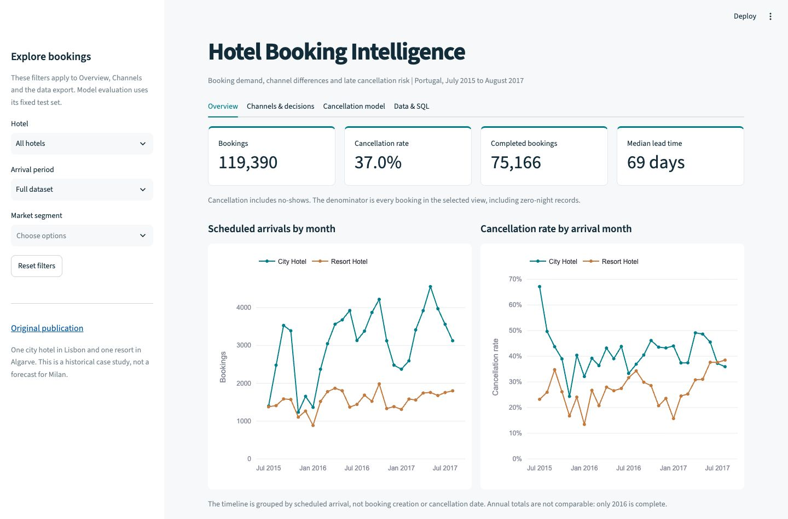
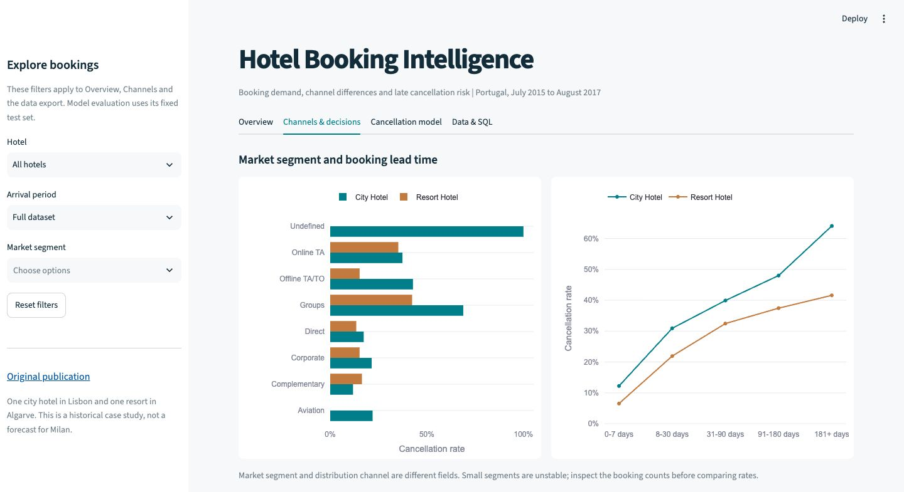
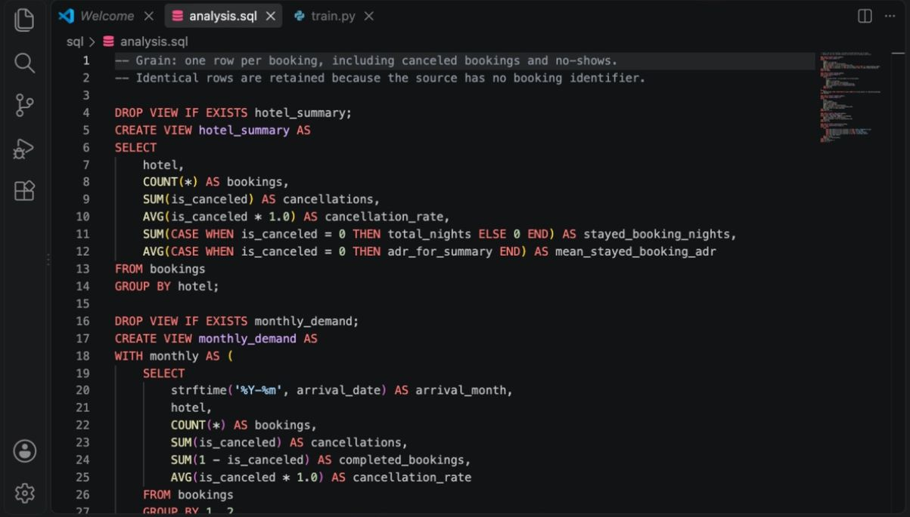
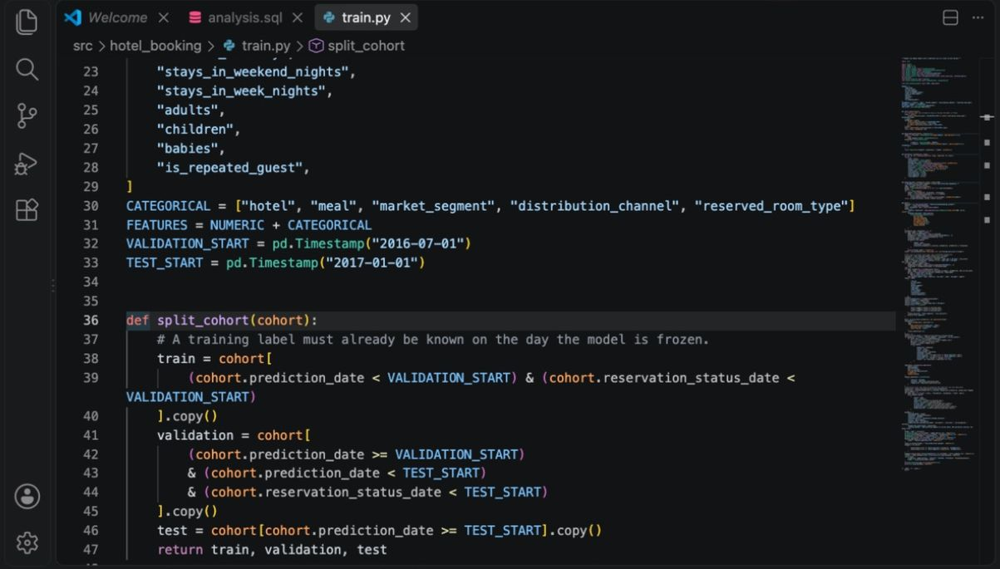
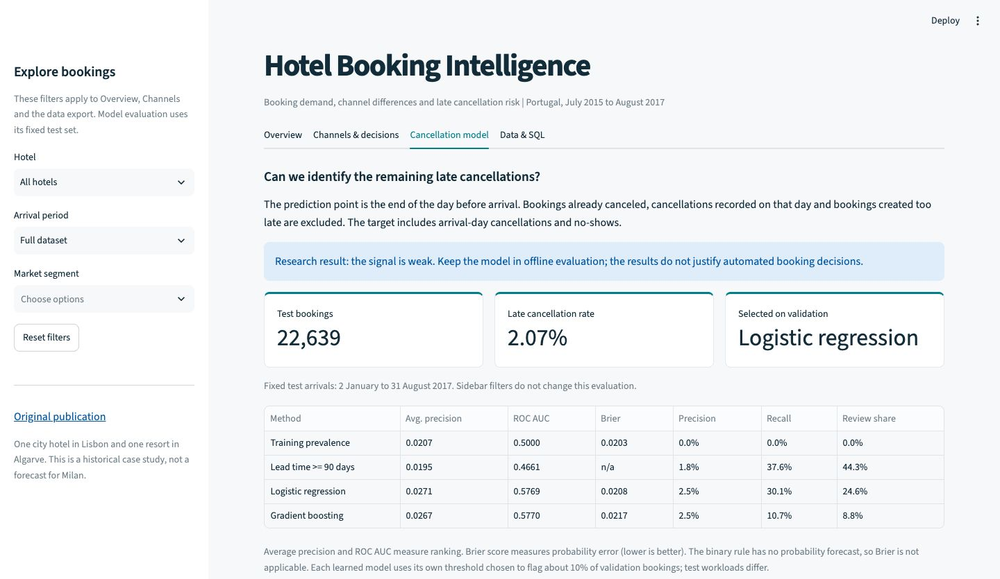
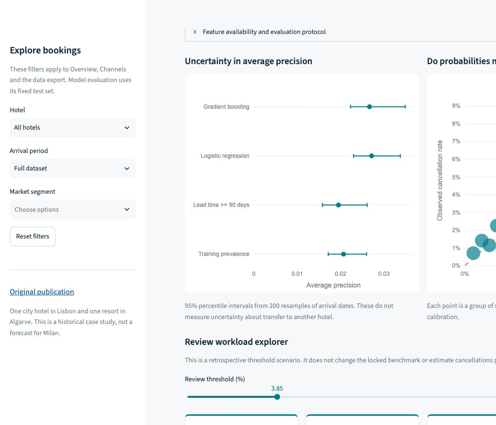

# Hotel Booking Analytics

Booking patterns, cancellation risk and insights for hotel management.

An analysis of **119,390 hotel bookings**: when guests plan to arrive, which bookings get canceled,
and whether the remaining cancellations can be identified before check-in.

**Python · pandas · SQLite · scikit-learn · Streamlit**

[Business findings](reports/management_brief.md) · [Model results](reports/model_results.md) ·
[Feature audit](docs/feature_audit.csv) · [Run locally](#run-locally)



## The business question

A hotel can have a strong booking pipeline and still lose a large part of it before arrival.
The useful questions are how that uncertainty changes through the year, where it is concentrated,
and whether a manager can act on a cancellation score without creating too many false alarms.

The dashboard separates the full booking analysis from a smaller, time-defined prediction problem.
Filters cover hotel, arrival period and market segment. The underlying rows can be exported as CSV.

## What the bookings show

| Observation | Result | A practical next step |
| :--- | :--- | :--- |
| Hotels behave differently | 41.7% cancellations in the city hotel, 27.8% in the resort | Keep separate planning baselines |
| Seasonality needs a comparable period | October had the most scheduled arrivals in 2016 for both hotels | Use the complete year before comparing seasonal peaks |
| Channel mix matters | Online TA: 36.7%; Direct: 15.3%; Groups: 61.1% | Review release dates and terms within comparable cohorts |
| Lead time changes the picture | 57.0% beyond 180 days, 9.6% at 0-7 days | Track long-lead bookings separately |
| Many cancellations happen early | Median: 54 days before arrival | Test an earlier confirmation workflow with new event data |

These are observed differences, not causal effects. The [management brief](reports/management_brief.md)
explains the proposed actions and their limits.



## A closer look at the data work

The original CSVs contain padded strings, missing values, zero-night records and 31,994 identical
rows. Identical rows are kept because the source has no booking ID: separate group bookings can
look the same. Removing them would change the overall cancellation rate from 37.0% to about 27.5%.

The cleaning script preserves the original ADR, flags two values for review and keeps unknown
children as missing. SQL views produce the saved hotel, monthly, channel and lead-time summaries.
Counts are reconciled against the authors' published totals.



[Read the SQL](sql/analysis.sql) · [Cleaning script](src/hotel_booking/prepare.py) · [Data notes](docs/data_notes.md)

## Prediction time comes first

The paper describes feature values reconstructed relative to the day before arrival. Those values
cannot be treated as a snapshot from the moment of booking.

The model therefore asks a narrower question: **among bookings still eligible at the end of D-1,
which will become late cancellations or no-shows?** Earlier cancellations and same-day timing
ambiguities are excluded. Fourteen inputs are retained after reviewing the source definitions.

Training, validation and test follow time order. A row can enter training or validation only if
its outcome was already known before that period's model freeze. Status, final status date,
deposits, assigned rooms and transaction-derived ADR never enter the model as predictors.



[Read the training code](src/hotel_booking/train.py) · [Full evaluation protocol](docs/model_card.md)

## What the model actually achieves

Logistic regression was selected on validation, ahead of a small gradient-boosting model.
The held-out test period contains **22,639 bookings and 468 late cancellations or no-shows**.



Average precision is **0.0271**, against **0.0207** for the prevalence baseline. At the frozen
threshold, the model identifies 141 cancellations, raises 5,434 false alarms and misses 327.
Its Brier score is worse than the constant forecast. This is a small ranking improvement with
substantial operational limits, so the model stays an offline experiment.

The dashboard includes calibration, uncertainty intervals, errors by segment and a threshold
slider to explore review workload. Changing the slider does not change the locked benchmark.

<details>
<summary>See calibration and the review workload</summary>



</details>

[Detailed results](reports/model_results.md) · [Metrics CSV](artifacts/model_metrics.csv) ·
[Examples of wrong predictions](artifacts/error_examples.csv)

## Run locally

Python 3.12 is required. Clone the repository, then install and run it with [uv](https://docs.astral.sh/uv/):

```bash
git clone https://github.com/Gr1gorii/hotel-booking-analytics.git
cd hotel-booking-analytics
uv sync --frozen
make all
make app
```

`make all` downloads the authors' CSV files, checks their hashes, builds the SQLite database,
trains the models and writes the reports. Internet access is needed for the first data download.
Open the local address printed by Streamlit. No account or API key is required.

Without `make`, run the individual steps:

```bash
uv run python run.py prepare
uv run python run.py train
uv run python run.py report
uv run streamlit run app.py
```

The alternative pip setup is `pip install -r requirements.txt` in a Python 3.12 virtual environment.
`uv.lock` contains the full reproducible dependency lock. Raw data, the local database, predictions
and the fitted model are generated locally and excluded from Git. Small result tables and screenshots
are included so the analysis can be reviewed without running it.

## Project layout

```text
app.py                    Streamlit dashboard
run.py                    Run data steps from the checkout
src/hotel_booking/
    prepare.py            Download, clean, build the data tables
    train.py              Split, fit, compare and inspect errors
    report.py             Generate the two written readouts
sql/analysis.sql          Five analytical SQL views
artifacts/                Saved metrics and aggregate tables
reports/                  Business findings and model results
docs/                     Definitions, feature audit and screenshots
tests/                    Data, time-boundary and dashboard checks
```

Run `make test` after building the data. The checks cover source totals, SQL reconciliation,
prediction eligibility, label availability, excluded features, saved metrics, filters and empty views.

## Limits and next step

The data cover one Lisbon city hotel and one Algarve resort between July 2015 and August 2017.
Only 2016 is a complete year. They cannot establish current demand in Milan, hotel occupancy,
RevPAR, preventable cancellations or the revenue effect of changing booking terms.

A useful next step is a shadow evaluation using timestamped snapshots and cancellation events
from a new hotel. Earlier snapshots would allow a more actionable forecast, for example seven
days before arrival. Contact costs and intervention outcomes would then support an impact test.

## Source

Antonio, N., de Almeida, A., & Nunes, L. (2019). *Hotel booking demand datasets*. Data in Brief, 22, 41-49.
[Publication](https://pmc.ncbi.nlm.nih.gov/articles/PMC6297060/) · [DOI](https://doi.org/10.1016/j.dib.2018.11.126)

The CSVs come directly from the publication's supplementary files through Europe PMC.
The original data and publication are credited under CC BY 4.0. Project code uses the [MIT license](LICENSE).
